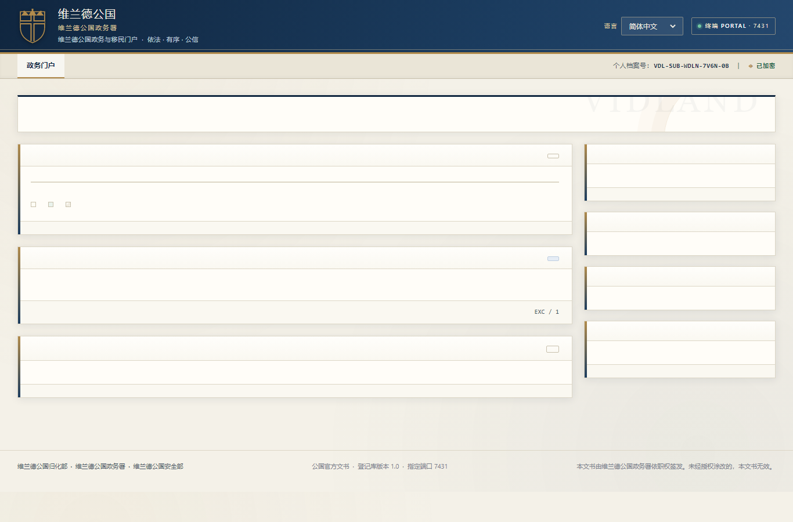
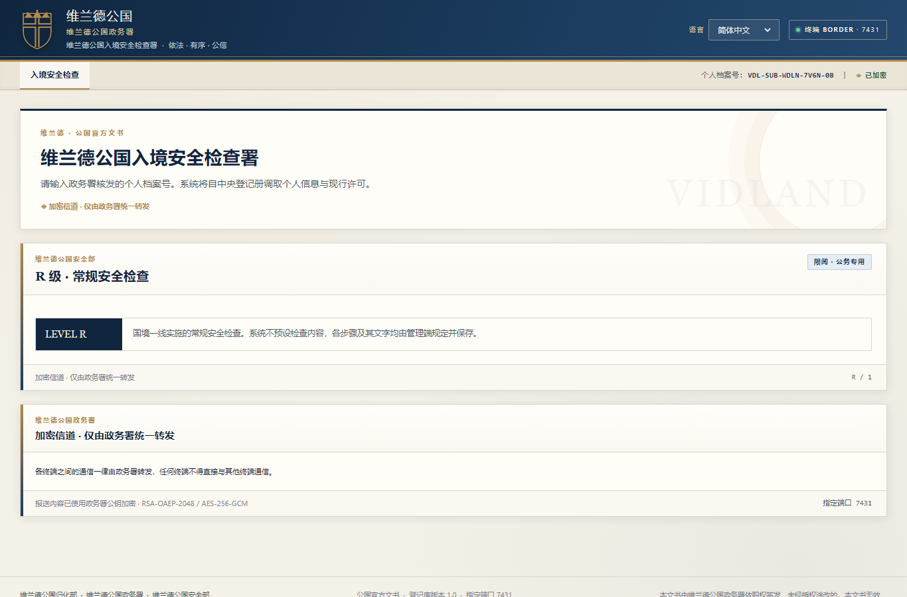
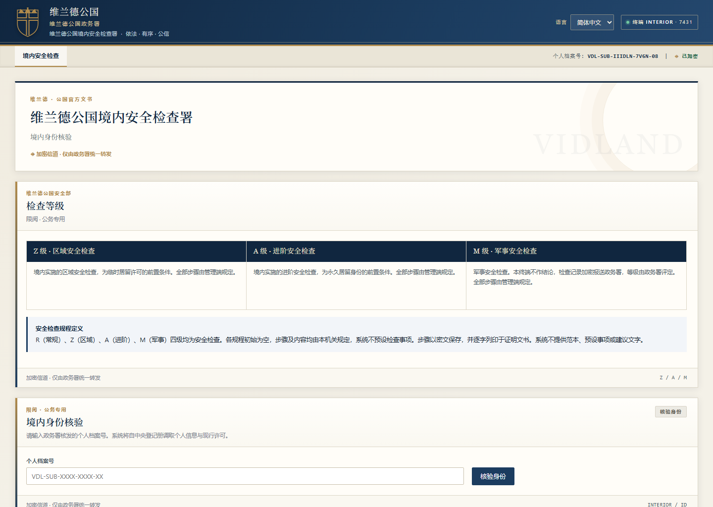
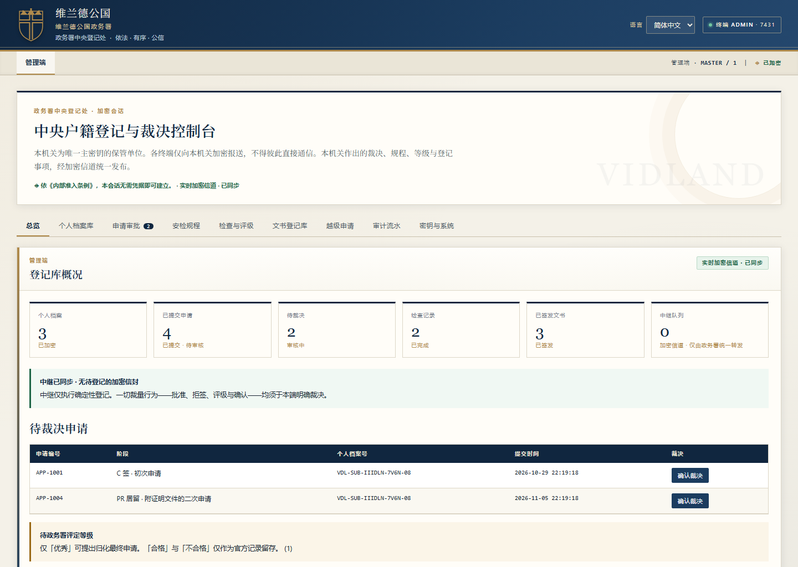

# 维兰德公国 · 政务模拟终端（Vidland）

> 这是一个**虚构公国**的政务 / 安检角色扮演网页应用，定位是**游戏与模拟器**，**不是任何真实国家或政府系统**。

## 关于 AI 辅助

本项目在 AI 编程助手全程协助下完成：界面与交互逻辑、政务申请表单与加密登记册、六语词库、本地存档方案等，均由人工设定方向与边界、AI 协作生成并打磨。它既适合作为「AI 辅助开发」的一个示例，也欢迎在其之上继续改造。

## 它是什么 / 能用来做什么

维兰德公国是一个架空的微型主权实体。这套终端把「入境—境内—管理」的政务流程做成了可在浏览器里直接运行的模拟器，主要用途是：

- **桌面角色扮演（TTRPG）/ 跑团道具**：GM 与玩家可用它递交、审核、签发各类申请与许可。
- **世界构建与推演**：把一套自洽的行政法规、安检分级（R / Z / A / M）、密文登记册跑起来，作为设定集的活道具。
- **前端原型 / 教学示例**：纯静态、无框架、五端同源，方便拆解学习。

## 五个终端（同源共用一份登记册）

| 终端 | 页面 | 说明 |
| --- | --- | --- |
| 政务门户 Civil Affairs Portal | `index.html` | 申请、表单、登记册查看 |
| 入境安检 Frontier Inspection | `border.html` | R 级审查，第一个检查点为认证身份 |
| 入境核验 Frontier Admission | `entry.html` | 核对至少两项个人信息后给出 ADMIT / HOLD / REFUSE |
| 境内安检 Interior Inspection | `interior.html` | Z / A / M 级审查 |
| 中央登记 Chancellery Authority | `admin.html` | 审核、签发、规程定义、统计 |

另有**本机审计端** `http://127.0.0.1:7433/`，只监听回环地址，用于审批手机等局域网设备的访问申请、掐断令牌和一键清零。它不是第六个业务终端，不读写政务登记册。

## 技术说明

- **纯静态**：HTML + CSS + 原生 JS，无构建步骤。
- **一份存档，五端共用**：申请表草稿、事件信封和加密登记册都由服务端写入本机 `vidland-data/store.json`。浏览器按「键」提交增量（`{vdl:1, baseRev, set, del}`），靠版本号轮询同步；电脑、手机、平板看到的是同一份登记册。
- **无需授权文件夹**：旧版让浏览器直接写文件的 File System Access 路径已移除，不再有「选择 data 文件夹 / 授权」这一步，也不会出现两份对不上的存档。服务器随控制台一起启动，关掉浏览器或重启服务器都不会丢数据。
- **本机免证书警告**：局域网模式下服务端在同一个端口同时接受 HTTPS（手机）和本机回环 HTTP（`http://127.0.0.1:7431`）。回环地址本身就是浏览器的安全上下文，加密接口可用，也不会弹自签证书提示。其他设备发来的明文请求一律拒绝。
- **六语界面**：词库 780 条 × 6 列（英 / 西 / 法 / 简体 / 繁体 / 俄），终端与门禁、审计端均可切换。
- **主私钥不出服务端**：申请材料用公钥加密报送，解密只由服务端 `/api/vault/open` 完成。RSA 私钥以 DPAPI 封装保存在本机 `vidland-data/master.key`，广播种子只经鉴权接口 `/api/vault/seed` 下发，任何终端页面都不持有密钥或种子。
- **终端独立图标**：每个终端有专属的深蓝金纹章图标，加到手机主屏后显示为不同的定制图标与名称。

## 安检规程：TXT 与管理端双向实时同步

四级规程出厂时完全空白，步骤和内容都由管理端规定。**不需要手动导入**：服务器启动后自动读取 `protocols/` 文件夹，管理端「安全检查规程定义」页也会自动同步。

| 在哪改 | 结果 |
| --- | --- |
| 编辑 `protocols/` 里的 txt | 几秒内自动同步到管理端和加密存档 |
| 在管理端增删/编辑步骤 | 自动写回 `protocols/` 的 txt，并同步到其他终端 |

- 文件名以等级字母开头：`R.txt`、`Z.txt`、`A.txt`、`M.txt`，也允许 `R-常规.txt` 这类带说明的名字。管理端写回时每个等级固定规范为一个文件。
- 未提供文件的等级不会被改动。
- 每个步骤用一行 `##` 开始，标题和正文用 `@语言.title:` / `@语言.detail:` 逐行写出；也支持 `## 步骤标题` + 直接写正文的简写。完整格式见 `protocols/格式说明.txt`。
- 支持 UTF-8（含 BOM）和 GBK/GB18030 编码。
- 两端同时改时，管理端会用文件版本号检测冲突并提示「从文件刷新」，不会静默覆盖你刚写的内容。
- 服务端只处理明文 txt 和只读扫描；浏览器端通过既有的加密写入通道保存，密钥不出浏览器，并照常同步、写入台账。

局域网模式下，规程文件接口只对电脑本机开放。除格式说明外，`protocols/` 下的 txt 不进入版本库。

## 安检终端与入境核验

- **入境安检 / 境内安检**：不再有独立的身份核验表单。「认证身份」是检查流程的**第一个检查点**——输入个人档案号后与中央登记库比对，登记有待办安检任务或有效资格才能开始后续检查；无资格会显示提示与原因。
- **入境核验**（`entry.html`）：从入境安检页的模块入口跳转的独立界面。输入至少两项个人信息（姓名、出生日期、护照号、国民身份号），核对相符后才显示完整登记档案，并给出入境判定：
  - `ADMIT` 准许入境（公民身份或持有效许可且无待办安检）
  - `HOLD` 暂缓（尚有 R 级安检未完成，或安检已通过但许可未核发）
  - `REFUSE` 不准许（未登记有效许可或长期资格）
  - 匹配不到档案 / 多份档案同等匹配 / 只填一项时，不披露任何完整档案。

该页面会展示完整个人信息，因此局域网设备打开时须先通过访问审批（见下一节）。

## 移动设备访问审批与本机审计端

手机、平板等局域网设备打开 `admin.html` / `entry.html` 时，服务端**不会下发真实页面**，只返回一个不含业务内容的门禁页。设备提交访问申请后显示「等待批准」；本机操作人员到 `http://127.0.0.1:7433/` 批准后，页面自动切换到真实终端。批准前页面里没有登记数据、没有申请记录、也没有业务脚本。

- **审计端无需口令**：只监听 `127.0.0.1`，靠回环来源、逐请求 Host / Origin 校验、由本机密钥签名的 HttpOnly 会话 Cookie 与写操作专用请求头确认身份。局域网设备连不上这个端口，打开首页即自动建立会话。
- **默认标准模式**：只审 `admin.html` / `entry.html`；门户、入境安检、境内安检免审批直接可用。启动服务时加 `VDL_STRICT=1` 可开启严格模式，五个终端页面、`vidland-core.js` 与所有登记接口都要求已批准令牌。
- **令牌**：批准后以 HttpOnly + SameSite=Strict Cookie 下发，页面脚本读不到，台账只存 SHA-256 哈希。审批时可设有效期、每日允许时段、适用终端和一次有效；令牌绑定浏览器 UA 哈希。一次批准默认覆盖该设备的全部终端。
- **掐断**：审计端可停用单个令牌、停用并掐断某台设备，或一键掐断全部。生效后页面立即抹掉内存中的登记数据并跳到终止页，服务端随后也只返回零业务门禁页；申请人可在终止页重新提交申请。
- **一键清零**：审计端右上角按钮清除全部申请、令牌、设备、审计记录与默认策略，且不留清零记录；DPAPI 密钥文件与 `vidland-data/store.json` 政务登记册保留。清零后所有已批准的移动设备立即失效。
- **主屏幕应用**：iOS 以「添加到主屏幕」方式启动时使用独立存储容器，Cookie 与浏览器标签页不共享，会显示成另一台设备，需要单独批准。申请记录会标注「浏览器标签页 / 主屏幕应用」。
- 门禁页的轮询只是访问心跳，**不参与安检中断或超时判定**；安检规则仍按项目约定执行（中断即不合格，静置、切后台不算中断，且不使用任何计时器）。

## 令牌状态与策略的作用范围

审计端三个页签（访问申请 / 令牌 / 设备与时间窗）现在共用同一个 `effective` 状态，由服务端按**与令牌校验完全相同**的规则计算：生效中、已掐断、设备已停用、已过期、时间窗外、会话时长用尽。过期或不在允许时段的令牌不会再显示「有效」。

任何一处执行掐断，三处同时更新：

- 首页「一键掐断全部」→ 全部令牌撤销、相关申请改为已掐断、设备打上掐断标记（不改「停用」，设备以后仍能重新申请）；
- 令牌页单个「掐断」→ 只影响该令牌及其申请；
- 设备页「停用并掐断」→ 撤销该设备令牌，并把它的待审 / 已批准申请一起改为已掐断。

设备页保存的有效期、每日时段、会话时长、终端范围与一次有效，会**立即作用到该设备已签发的令牌**，并作为该设备后续批准的基线；批准表单里没改动过的默认值不会再把它覆盖掉。

### 三个时间参数到底在哪生效

| 参数 | 实现 | 生效位置 |
| --- | --- | --- |
| 有效期（小时） | `notAfter = 签发时间 + N 小时`，最长 30 天 | 受保护终端的数据请求 + 门禁轮询 |
| 每日允许时段 | 服务器本地时间，支持跨午夜窗口 | 同上 |
| 会话时长（分钟） | 从**签发时刻**起算的总时长，不是空闲超时 | 同上 |
| 一次有效 | 第一次业务请求后作废 | 同上 |

**边界（实测确认）**：标准模式下门户 / 入境安检 / 境内安检是免审批的，`/api/store` 不校验令牌，所以这三个参数对它们不起作用；电脑本机回环访问也不校验。要让五个终端全部按令牌策略走，用 `VDL_STRICT=1`。门禁轮询始终按同一规则判定，失效时会锁屏并抹掉内存里的登记数据。

`/api/store/rev` 的每秒版本轮询只是传输探测，不计入使用次数，也不会消耗「一次有效」令牌。

自查用 `python audit_vault.py --verify`；审计端三个页签显示的徽章就是同一份状态。

## 添加到手机主屏幕

五个终端都配好了 `apple-touch-icon`（180×180）、Web App Manifest（192 / 512）、SVG 矢量 favicon 和主题色。用手机 Safari / Chrome 打开对应终端，选择「添加到主屏幕」，即可看到该终端专属的图标和名称（政务门户 / 入境安检 / 入境核验 / 境内安检 / 中央登记）。

图标资源在 `icons/`，已随仓库分发。若要修改图案或名称，编辑 `make_icons.cjs` 后重新生成：

```
node make_icons.cjs
```

生成脚本用 Chrome/Edge 自带的渲染器把 SVG 母版栅格化成 PNG，不需要额外依赖；找不到浏览器时可用 `VDL_CHROME=C:\path\to\chrome.exe` 指定。

## 局域网访问（手机 / 平板）

把电脑当作服务器，让同一 WiFi 下的移动设备访问。存档仍然写在**电脑本机**，各设备通过轮询服务端版本号实时同步。

**手机为什么必须用 HTTPS**：浏览器只允许在安全上下文（`https://` 或 `localhost` / `127.0.0.1`）里使用加密接口。用 `http://192.168.x.x` 这种局域网 IP 访问时，`crypto.subtle` 不可用，整个加密登记册会失效。

**电脑上不用装证书**：局域网模式下，服务端在同一个 7431 端口按连接的第一个字节自动区分 HTTPS 和明文 HTTP。本机直接打开 `http://127.0.0.1:7431/index.html` 即可——回环地址本身就是安全上下文，不会有「不安全」提示，功能与手机端完全一致。控制台 `[4]` 状态和 `[5]` 打开各终端给的都是这个地址；其他设备发来的明文请求一律拒绝，只能走 HTTPS。如果本机还想让 `https://...` 的旧书签也保持绿色，按 `[6]` 或运行 `python quickstart.py trust` 一次即可：根证书会静默加入当前用户的受信任根证书存储（无需管理员权限、不弹窗），重开一次浏览器生效。

### 一键启用

```
python quickstart.py lan
```

等价的手动方式：

```
python make_cert.py
VDL_LAN=1 python serve.py
```

`VDL_LAN=1` 会自动开启 TLS 并绑定 `0.0.0.0`。未设置时行为与原来完全一致（本机纯 HTTP）。

首次运行需要 **OpenSSL** 来生成证书。脚本会先在 PATH 里找，找不到时自动探测常见安装位置（Git for Windows、OpenSSL-Win、WorkBuddy 自带 PortableGit 等），所以双击 `quickstart.bat` 也能用。万一你的机器上确实没有，控制台会直接给出原因和三种解法；也可以手动指定：

```
VDL_OPENSSL=C:\path\to\openssl.exe python quickstart.py lan
```

安装 Git for Windows 是最省事的办法（自带 `openssl.exe`）。证书文件本身不进仓库，别人 clone 后需要各自生成一套。

### 手机端：每台设备装一次根证书

**先在 Safari 地址栏手动完整输入这个纯 HTTP 地址**（注意是 `http://`，端口 7432）：

```
http://192.168.x.x:7432/
```

这是一个专门的「证书下发页」，只提供公开的根证书和一段说明，不含存档、私钥或任何应用文件。为什么要用 HTTP：装 CA 需要先打开 HTTPS 页面，而 HTTPS 又要求先信任这个 CA——直接访问主站会卡在这个死循环里，iOS 18.2+ Safari 常报 `Navigation failed because the request was for an HTTP URL with HTTPS-Only enabled`。旁路端口把它拆开了。

- **iPhone / iPad**：点页面上的「下载配置描述文件」（`.mobileconfig`，iOS 原生格式，比 `.crt` 可靠）→ 「设置 → 通用 → VPN 与设备管理」安装 → **再到「设置 → 通用 → 关于本机 → 证书信任设置」开启完全信任**。最后这步最容易漏，不做等于没装。
- **Android**：点「下载根证书 (.crt)」→「设置 → 安全和隐私 → 更多安全设置 → 加密和凭据 → 安装证书 → CA 证书」→ 确认锁屏密码。Android 7 之后用户 CA 属于「用户凭据」，部分 App 默认不信任；Chrome 若仍提示不安全，可在 `chrome://certificate-manager` 里再导入一次（部分国产 ROM 还有「允许用户证书用于 VPN 和应用」开关需打开）。

装好后，**在 Safari 地址栏手动完整输入** `https://192.168.x.x:7431/index.html`（必须带 `https://`）。不要只输 IP，也不要从聊天记录或书签点链接跳转——HTTPS-Only 模式会把这类请求当成 http 拦下来。若仍弹「不安全连接警告」，可临时在「设置 → App → Safari → 隐私与安全性」关闭该开关，装完证书后再打开。

备用直链（证书装好后可用）：`https://192.168.x.x:7431/ca.mobileconfig`、`.../ca.crt`、`.../ca.pem`。旁路端口可用 `VDL_CA_PORT` 修改，需同步放行防火墙。

**两个端口别搞混**：

| 用途 | 地址 |
| --- | --- |
| 装证书（引导页） | `http://192.168.x.x:7432/` |
| 用终端 | `https://192.168.x.x:7431/index.html` |

装完证书后请**点引导页上的链接**或重新输入 7431 的 HTTPS 地址，不要把 7432 那个地址的 `http` 直接改成 `https`——虽然旁路端口现在也能接受 HTTPS 并显示引导页，但那不是终端入口。若访问 7431 仍提示「无法建立安全连接 / 不支持 HTTPS」，按顺序排查：

1. iOS 是否已在「设置 → 通用 → 关于本机 → 证书信任设置」开启**完全信任**（最容易漏）；
2. 手机「设置 → 通用 → 日期与时间」是否开启自动设置，时间偏差会让证书被判无效；
3. 确认服务启动横幅显示 `Chain: fullchain`。服务端会发送「叶子 + CA」完整证书链，只发叶子证书时 iOS 会直接拒绝；
4. Safari 清除历史记录与网站数据后重试。

根证书有效期 10 年，装一次基本不用再管。临时偷懒：Android Chrome 首次访问时点「高级 → 继续前往」通常也能用，但会有警告条；iOS Safari 一般不给这个选项。

### 证书过期 / IP 变了怎么办

**电脑上不需要做任何事。** 只要服务在跑（无论用 `python quickstart.py lan` 还是直接 `VDL_LAN=1 python serve.py`），它会在启动时检查、之后每 6 小时再检查一次，遇到以下情况自动重签服务器证书：

- 剩余有效期不足 30 天；
- 本机 IP 发生变化；
- 证书文件缺失。

重签后服务会**热重载 TLS 上下文，不重启、不中断连接**，并且**复用同一个根 CA**，所以手机上装好的根证书依然有效，全程零操作。启动横幅会显示 `Cert: 自动续签已开启` 和当前剩余天数。

想手动查看或触发也可以：

```
python make_cert.py --status   # 查看 CA / 服务器证书剩余天数与 IP 覆盖情况
python make_cert.py            # 需要时才重签（幂等）
python make_cert.py --force    # 立即重签服务器证书，仍保留 CA
```

只有 `python make_cert.py --new-ca` 会重建根 CA——**这会让所有手机必须重新安装证书**，除非私钥泄露否则不要执行。

如果你用 `VDL_CERT` / `VDL_KEY` 指定了自己的证书（例如 Let's Encrypt），自动续签会**自动跳过**，绝不覆盖你的文件，续期由你自己的 ACME 工具负责。检查周期可用 `VDL_CERT_CHECK_SEC` 调整（默认 21600 秒），设为 `0` 可关闭后台检查但保留启动时检查。

服务器证书固定 365 天（iOS / Safari 拒绝有效期超过 398 天的证书），根 CA 为 3650 天。真到了 CA 也过期的那天（十年后），重建一次并让手机重装即可。也可以用 `VDL_LAN_IP` 指定额外 IP，或用 `VDL_LAN_DNS` 追加域名。

**证书不随仓库分发**：`vidland-data/` 整个目录被 `.gitignore` 忽略，CA、服务器证书和两把私钥都只存在于本机，从未提交。别人 clone 这个项目后运行 `make_cert.py` 会生成一套**全新的、与你完全不同的** CA 和密钥对，他们的手机要装自己那套 `ca.pem`。这是刻意的——共用私钥等于把私钥公开，TLS 也就失去意义了。

如果手机连不上，需要放行 Windows 防火墙的 TCP 7431 入站（专用网络）：

```
netsh advfirewall firewall add rule name="Vidland LAN 7431" dir=in action=allow protocol=TCP localport=7431 profile=private,domain
```

### 安全说明

- **主私钥不在页面里**。它只以 DPAPI 封装保存在本机 `vidland-data/master.key`，申请材料由服务端 `/api/vault/open` 解密后返回业务明文。手机访问 `admin.html` / `entry.html` 改为「先审批、后下发」，不再靠一刀切的 403 拦住整个管理端。`VDL_ADMIN_LAN` 现在只控制规程草稿接口是否对局域网开放，与页面访问无关。
- 7431 端口按白名单只提供五个终端 HTML、四个公共 JS、一个 CSS、图标资源与 `/ca.*`；`vidland-data/`（含私钥、密文档案、审计库）、`.git/`、`*.py`、`gate.html`、`audit.html` 都不可下载。审计端页面只由 7433 回环端口提供。
- 证书是本地自签的。若希望手机**完全免配置**，可改用自有域名 + Let's Encrypt（DNS-01 挑战）签发的证书，把 A 记录指向内网 IP，再用 `VDL_CERT` / `VDL_KEY` 指定证书路径即可，服务端代码无需改动。

## 主密钥轮换

申请材料的 `payload` 用混合信封加密：AES-256-GCM 加密业务明文，RSA-OAEP 把数据密钥封给政务署公钥。私钥以 DPAPI 封装保存在本机 `vidland-data/master.key` 的**版本化密钥环**里，只有服务端 `/api/vault/open` 能解开。每个信封都带 `kid`（公钥指纹），服务端按代选私钥。当前生效的公钥属于运行时状态，放在 `vidland-data/current.pub.json`；仓库里的 `vidland-core.js` 只保留出厂基线，服务端下发时在线替换，所以**自动轮换不会改动任何被 git 跟踪的源码**。

### 自动轮换（默认开启）

服务进程内有一个守护线程，默认每 **7 天**换一次，实际间隔由操作系统 CSPRNG 在 ±40% 区间随机抽取（约 4–10 天），到期时间写进 DPAPI 封装的密钥环，重启不会重置也不会漏掉。新密钥用 `secrets.token_bytes` 作 RSA 随机源，默认 **RSA-3072**。

轮换是**热**的：不停服务、不刷新页面、不改源码。

- 新代私钥追加到密钥环并成为活动代；当前公钥写到 `current.pub.json`；
- 已经打开的页面继续用旧公钥，服务端保留旧代私钥，照样能解；新开的页面自动用新公钥；
- 服务端遇到内存里没有的 `kid` 会重读密钥环，因此轮换后不需要重启进程；
- 密钥环默认保留最近 **3 代**。淘汰最老一代之前，会先把仍用它的密封信封重封到活动代，明文只在进程内存中出现，不落盘；
- 跨进程互斥锁防止定时任务和手动命令同时改密钥环；每次轮换写一条加密审计记录。

| 环境变量 | 默认 | 说明 |
| --- | --- | --- |
| `VDL_ROTATE_DAYS` | `7` | 基准间隔（天），`0` 关闭自动轮换 |
| `VDL_ROTATE_JITTER` | `0.4` | 随机抖动比例，`0.4` = ±40% |
| `VDL_ROTATE_BITS` | `3072` | 新密钥位数（2048–4096） |
| `VDL_ROTATE_KEEP` | `3` | 保留的密钥代数 |

改完环境变量重启服务即可，启动横幅和 `[4]` 状态会列出当前配置。

### 查看状态与立即触发（不影响运行中的服务）

```
python audit_vault.py --info        # 活动代、代数、下次轮换时间、配置
python audit_vault.py --verify      # 逐份打开所有历史信封，列出每代引用数
python audit_vault.py --rotate-now  # 立刻热轮换一次（随机安排下一次）
```

`--verify` 失败会列出具体信封编号，适合放进日常巡检。

### 全量压缩（怀疑泄露时用）

```
python quickstart.py stop
python audit_vault.py --rotate      # 加 --keep-old 可保留旧私钥备份
python quickstart.py start
```

这条路径把**所有**历史信封重封到全新密钥、只留一代、删掉 `master.key.old`，并同步更新仓库基线公钥。它会全量改写登记册，所以要求停服；写入是原子的，校验失败自动回滚四个文件。手动执行后 git 会显示一次 `vidland-core.js` 改动，属于预期。自定义端口时先设 `VDL_PORT`。

### 生产级：做到了什么，做不到什么

**做到的**：CSPRNG 随机源与不可预测的调度、3072 位可配、调度状态随密钥环一起 DPAPI 封装、跨进程互斥锁、滑动窗口淘汰前重封、GCM 完整性校验、轮换写加密审计记录、公钥与源码分离、旧代私钥从磁盘删除、运行中零停机交接。

**架构上做不到的**（换实现方式也绕不过去）：

- **DPAPI 不是 HSM/KMS**：私钥仍在同一进程内存里，进程被攻破等于所有存活代一起泄露。真生产级要换成 KMS/HSM，或至少 Windows CNG 非导出密钥加分权审批。
- **git 历史里的旧私钥与旧密文**：早期版本把主私钥内联进过公开仓库，已视为泄露。自动轮换只保护新数据和当前登记册，已 clone / fork 的历史副本仍可能被那份旧私钥解开；改写 git 历史不会让已流出的副本消失。
- **前向保密**：静态登记册要求服务端随时重放解密历史，与「用完即弃的会话密钥」目标相反。
- **信封写入认证**：标准模式下三个民用终端对登记接口免审批，能连到 7431 的人可以写入信封。要收紧用 `VDL_STRICT=1`，或给写入加设备签名；这不是轮换能解决的。
- **物理内存覆写与单点**：Python / 浏览器做不到可靠内存擦除；静态服务、存档、审计库都在一台机器上，没有异地密钥托管与恢复。

建议：自动轮换默认开着，不必手动干预；把 `--verify` 放进巡检。真要承载敏感数据，先补密钥托管和写入认证，再谈缩短轮换周期——周期再短也补不上这两块。

## 使用截图









## 快速开始

1. 双击 `quickstart.bat`（或运行 `python quickstart.py`），按 `[1]` 启动本机模式，或按 `[2]` 启动局域网模式。
2. 用 **Chrome 或 Edge** 打开 `http://127.0.0.1:7431/index.html`（不要用 `file://` 直接双击打开）。两种模式下这个地址都能用，且不会有证书警告。
3. 不需要选择文件夹、不需要点授权。存档由服务端直接写入 `vidland-data/store.json`，五个终端自动实时同步。
4. 手机等局域网设备要打开管理端或入境核验时，在**电脑本机**浏览器打开 `http://127.0.0.1:7433/` 审批访问申请。该地址只在电脑本机可用，无需口令，启动横幅与 `[4]` 状态里都会列出。

### 两种模式与一键切换

控制台 `python quickstart.py`（或双击 `quickstart.bat`）的菜单与命令一一对应：

| 命令 | 菜单 | 模式 | 访问地址 |
| --- | --- | --- | --- |
| `python quickstart.py local` | `[1]` | 启动 / 切回本机 HTTP | `http://127.0.0.1:7431/index.html` |
| `python quickstart.py lan` | `[2]` | 局域网 HTTPS（手机） | 本机 `http://127.0.0.1:7431/` · 手机 `https://192.168.x.x:7431/` |
| `python quickstart.py stop` | `[3]` | 停止 | — |
| `python quickstart.py status` | `[4]` | 查看状态 | — |
| `python quickstart.py open` | `[5]` | 打开各终端 | — |
| `python quickstart.py trust` | `[6]` | 本机信任根证书（一次） | — |

菜单共 7 项：`[1]` 启动/切回本机、`[2]` 局域网、`[3]` 停止、`[4]` 状态、`[5]` 打开终端、`[6]` 本机信任根证书、`[0]` 退出。两个模式入口都会**先停旧服务再按新模式启动**，不必手动「停止 + 启动」；已经处于目标模式时不会无谓重启。`restart`、`log`、`start` 仍作为命令行命令保留。

`status` 会显示实际运行模式、重启将沿用的模式和正确地址——新开一个控制台也不会因为环境变量丢失而误报「不可达」。本机地址一律给 `http://127.0.0.1`，因为回环地址不需要证书。

`restart` 和命令行的 `start` 会按端口记住上次用的模式（`.workbuddy/vdl-last-mode-7431.txt`）。服务停机后直接 `python quickstart.py restart` 也会回到局域网模式，不会悄悄掉回只供本机访问的 HTTP；想换模式仍然按 `[1]` / `[2]`。

若要在手机等局域网设备上使用，改看上面的「局域网访问」一节：运行 `python quickstart.py lan`，手机通过 `https://` 访问，与电脑共用同一份 `store.json`；电脑端地址不用改。用完按 `[1]` 或运行 `python quickstart.py local` 即可回到纯本机模式。

## 许可证

本项目以 [Apache License 2.0](LICENSE) 发布。
